# Spring Plunger Blaster

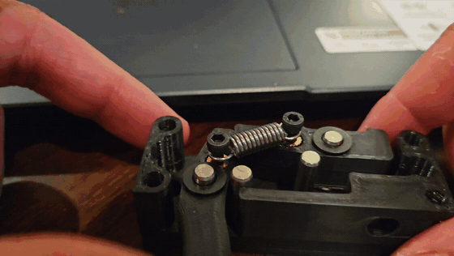

Solo design of a 3D printed, spring powered foam dart blaster in SolidWorks, with each mechanism prototyped and tested on its own.

| Context | Dates | My role | Tools | Status |
|---|---|---|---|---|
| Personal project | May to August 2024 | Sole designer | SolidWorks, SolidWorks Flow Simulation, FDM printing | Mechanisms prototyped and tested; full blaster not assembled |

**Case study:** [PDF](docs/Nerf_Blaster_Case_Study.pdf) · [web version](https://xiang-wang-us.github.io/projects/nerf-blaster.html)

## Highlights

- **4** mechanisms printed and tested on their own
- **3 months** from first barrel sketch to full assembly model

## Summary

A self directed summer project to design a spring plunger blaster from scratch. I modeled the whole blaster in SolidWorks, then printed and tested each mechanism on its own: plunger tube, catch and sear, trigger linkage, and muzzle device. The full blaster was not assembled.

## Plunger and barrel

A spring blaster stores energy in a compressed spring and releases it into a plunger that pushes a column of air behind the dart. I started from the barrel and plunger tube in May 2024, then printed a plunger head and tested it in a clear tube with the real spring.

<table>
<tr><td width="50%" valign="top">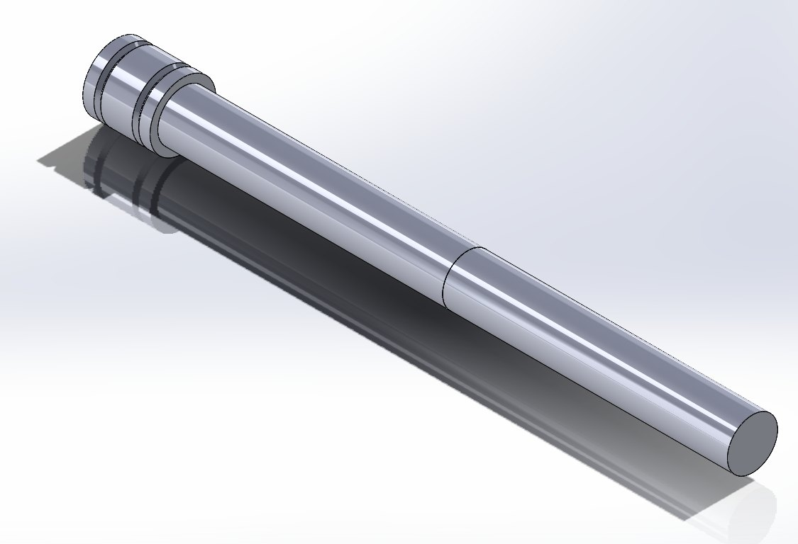 First barrel and plunger tube model</td><td width="50%" valign="top">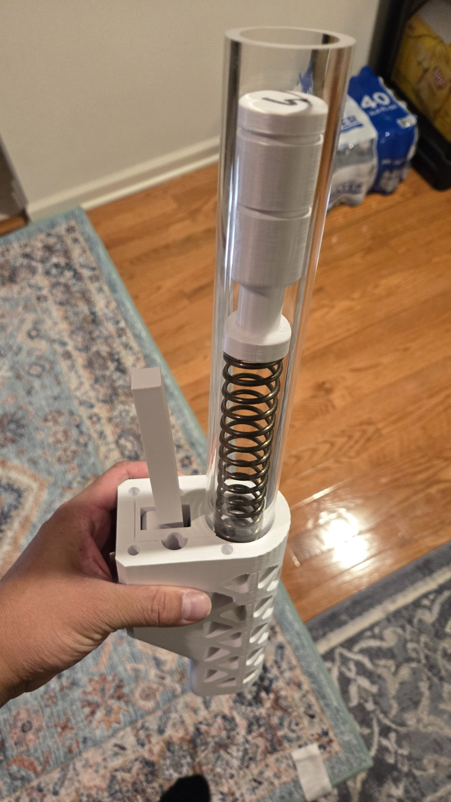 Printed plunger in a clear tube</td></tr>
<tr><td width="50%" valign="top">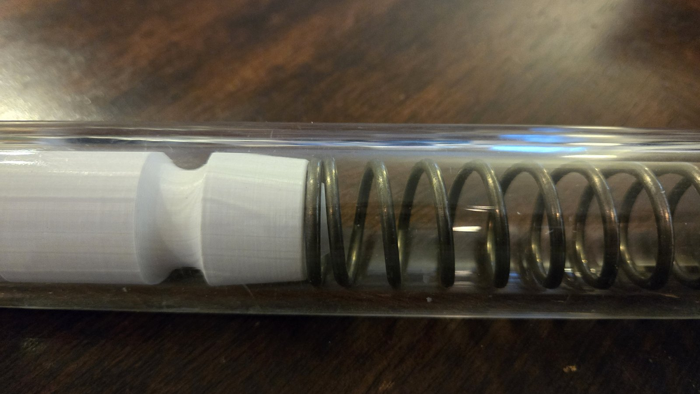 Spring and plunger head</td></tr>
</table>

Videos: [Plunger tube test fire](media/video/nerf_testfire.mp4)

## Catch, sear, and trigger

The catch holds the plunger against the spring until the trigger releases it, so it carries the full spring load. I worked the sear engagement out in section views, then built a linkage that carries trigger motion back to the sear across the receiver. Both were printed and cycled by hand.

<table>
<tr><td width="50%" valign="top">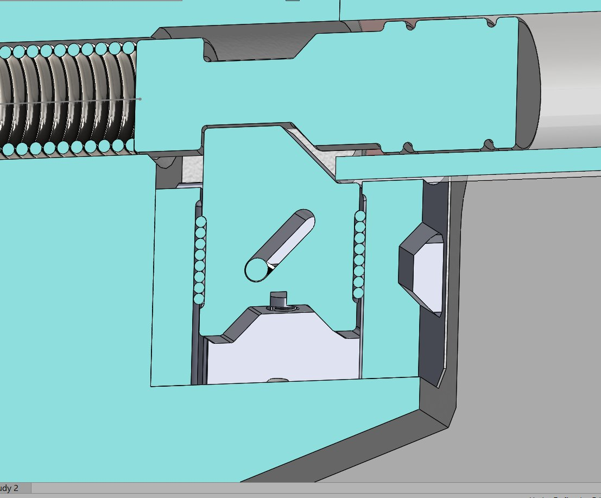 Sear and catch, section view</td><td width="50%" valign="top">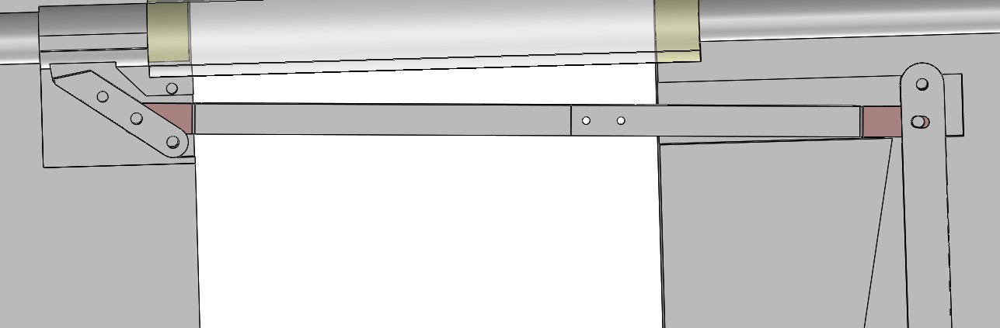 Trigger linkage to the sear</td></tr>
<tr><td width="50%" valign="top">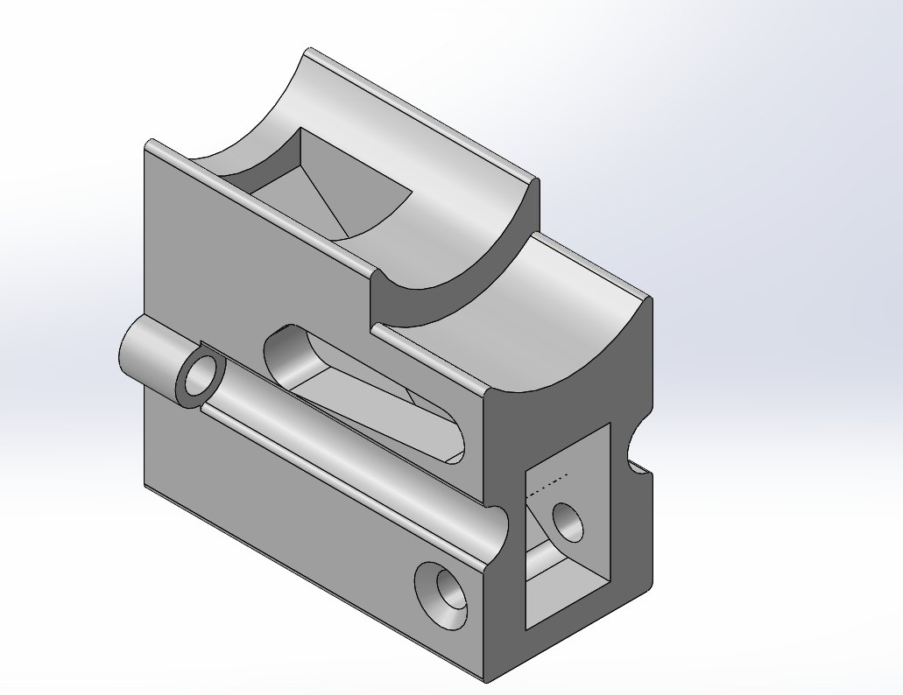 Receiver block</td></tr>
</table>

Videos: [Printed trigger and catch cycling](media/video/nerf_trigger.mp4), [Catch mechanism test](media/video/nerf_catch.mp4)

## Flow study and muzzle

I ran SolidWorks Flow Simulation on the air path through the breech and barrel to see where the flow speeds up and where it is restricted. The muzzle device and the stock were modeled last, in August 2024.

<table>
<tr><td width="50%" valign="top">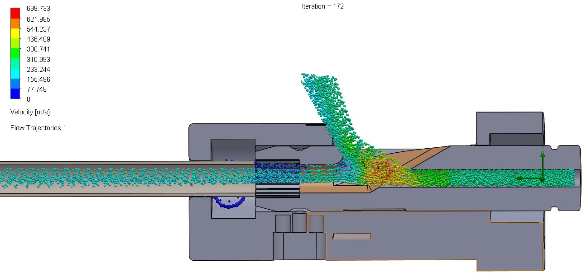 Flow trajectories through the breech</td><td width="50%" valign="top">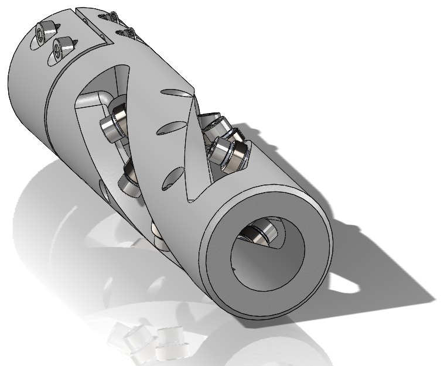 Muzzle device</td></tr>
<tr><td width="50%" valign="top">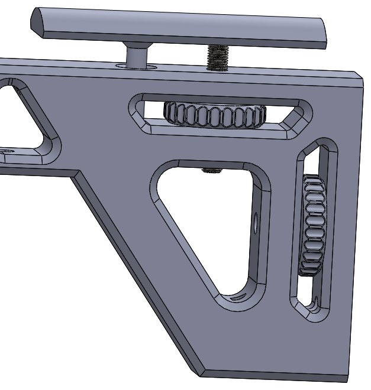 Stock</td></tr>
</table>

## Printing and status

Parts were printed on my Klipper tuned printer. Each mechanism was proven separately. Assembling the full blaster and measuring muzzle velocity are the open items.

<table>
<tr><td width="50%" valign="top">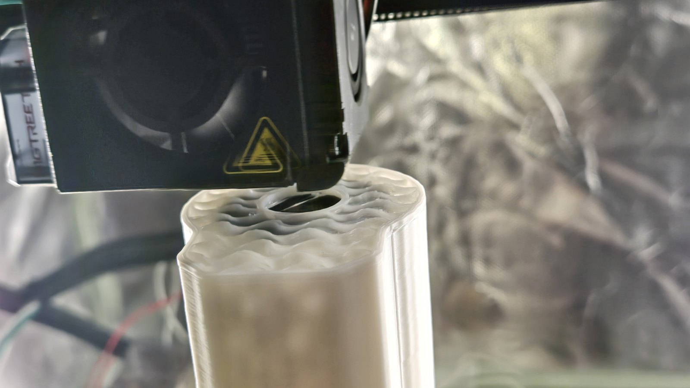 Printing a body section</td><td width="50%" valign="top">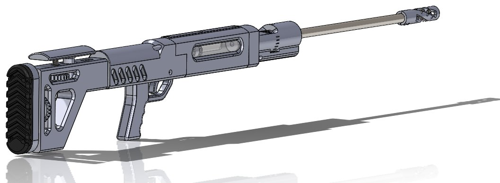 Full assembly model</td></tr>
</table>

## Files

| File | Path |
|---|---|
| Case study (PDF) | [`docs/Nerf_Blaster_Case_Study.pdf`](docs/Nerf_Blaster_Case_Study.pdf) |

---

Part of [Xiang Wang's engineering portfolio](https://xiang-wang-us.github.io). [LinkedIn](https://linkedin.com/in/xiangwang102) · [Email](mailto:20o5xwang@gmail.com)
